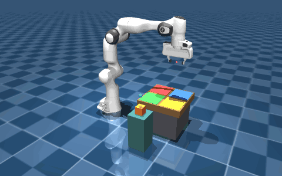
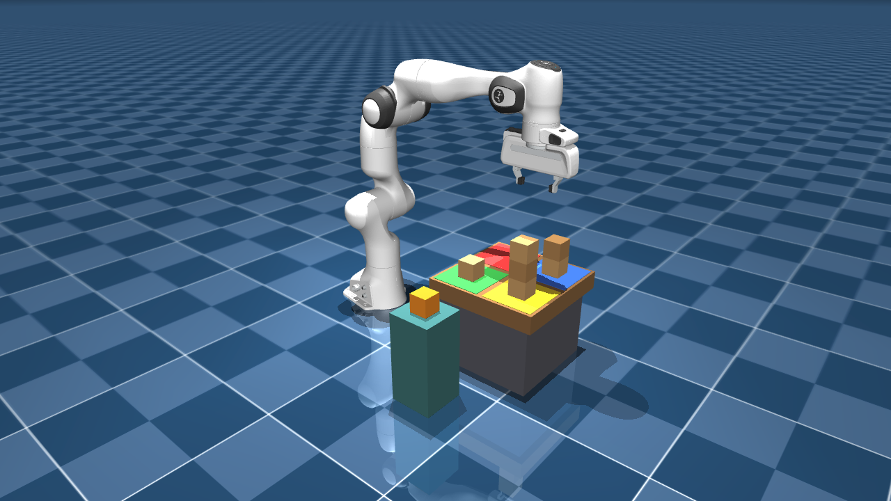
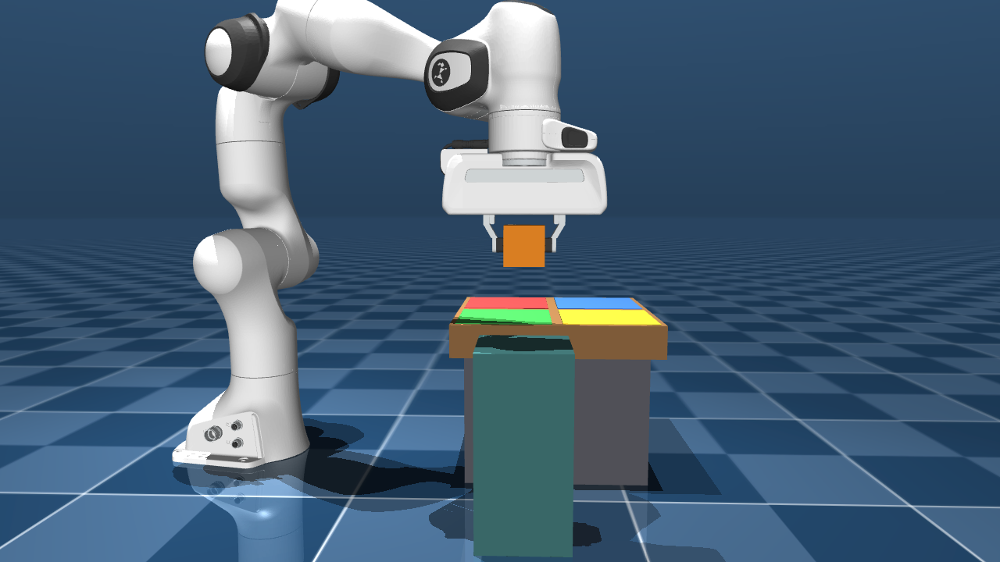
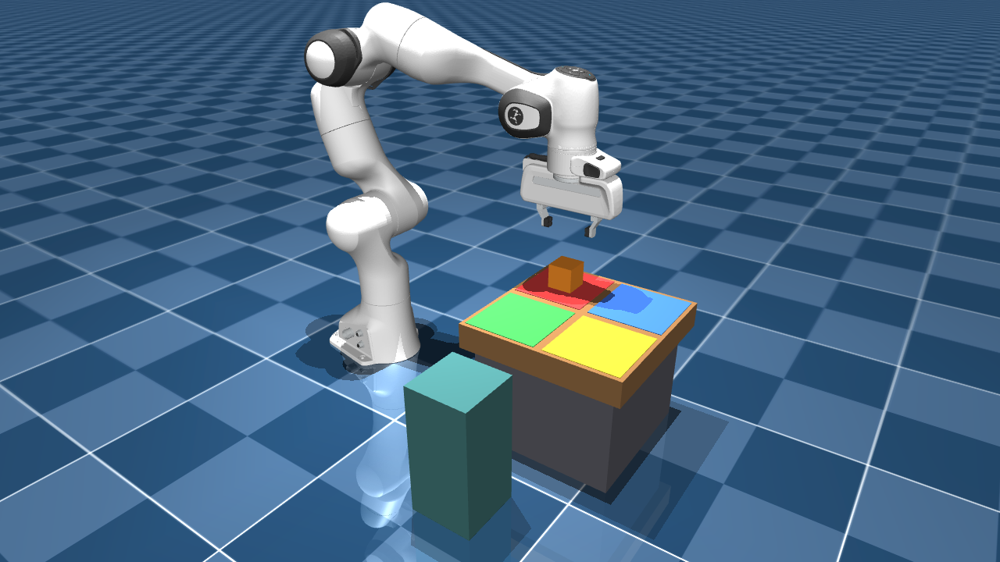
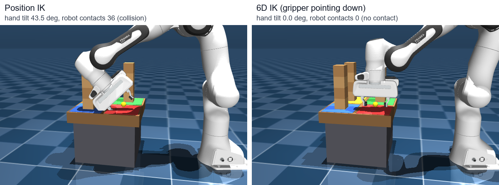
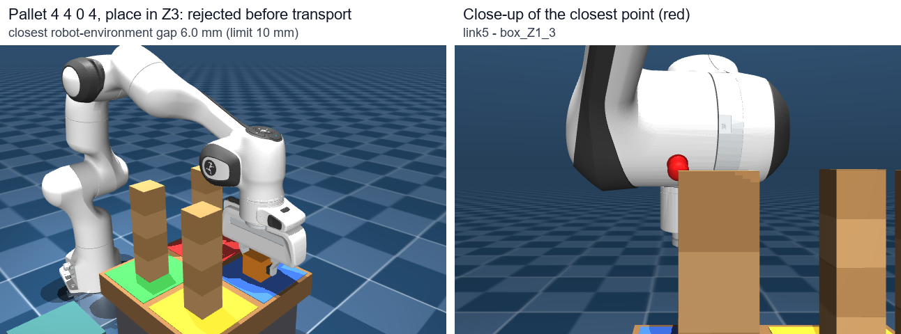

# MuJoCo Franka Panda 팔레트 적재 시뮬레이션

MuJoCo 물리 시뮬레이터에서 Franka Panda 로봇팔이 상자 1개를 집어 2×2 팔레트의 빈 구역에 내려놓는 과정을 구현한 개인 학습 프로젝트입니다.
FK/IK부터 시작해서 그리퍼 방향을 고려한 6D IK, 접촉·마찰만으로 상자를 잡고 옮기는 동작, 내려놓기까지 단계별로 만들고 각 단계를 수치로 검증했습니다.

> 이 프로젝트는 **시뮬레이션 실습**입니다. 실제 로봇으로 실험하지 않았고, 물류 현장의 팔레트 적재 로봇 사례에서 아이디어만 얻어 개인적으로 만든 것입니다.
> 특정 기업의 시스템을 재현하거나 공식 업무로 개발한 결과물이 아닙니다.



*빈 팔레트의 Z1 구역에 상자를 놓는 실제 시뮬레이션 결과 (오프스크린 렌더링, 시뮬레이션 0.6초마다 1장, 약 3배속). 회색 점은 계획 경로, 하늘색 점은 실제로 지나온 손끝 경로로 화면 표시용입니다.*

| 전체 환경 | 파지 후 들어 올림 | 내려놓은 결과 |
|---|---|---|
|  |  |  |
| 로봇, 공급 받침대(청록), 2×2 팔레트 (구역별 상자 0·1·2·3개) | 손가락 마찰로 잡은 상자를 받침대에서 10 cm 들어 올린 상태 | 빈 팔레트 Z1(빨강)에 놓고 손을 뺀 뒤의 상태 |

## 목적

- 로봇팔 기구학(FK, IK)을 직접 구현하고 물리 시뮬레이션에서 확인해 보기
- "목표 좌표에 손끝이 도착했다"에서 끝내지 않고, 실제 접촉과 마찰로 물체를 다룰 때 생기는 문제를 확인하기
- 이후 카메라로 적재 높이를 측정하고 적재 위치를 고르는 기능으로 확장할 수 있는 구조 만들기

## 개발 환경

| 항목 | 내용 |
|---|---|
| OS | Windows 11 Home (빌드 26200), PowerShell, VS Code |
| 하드웨어 | RAM 약 7.6 GB, Intel UHD Graphics 620 (+ NVIDIA MX150) |
| 언어 / 라이브러리 | Python 3.13.1, MuJoCo 3.15.0 (Python 바인딩, `mujoco.viewer`), NumPy 2.5.4 |
| 로봇 모델 | MuJoCo Menagerie `franka_emika_panda` (원본 파일 수정 없음) |
| 기타 | Git. 추가 패키지 설치 없이 MuJoCo가 함께 설치하는 패키지만 사용 |

코드 작성과 디버깅에는 AI 코딩 도구(Claude Code)를 활용했습니다. 단계별 목표와 검증 기준을 정하고, 결과를 MuJoCo Viewer와 테스트 수치로 확인하면서 진행했습니다.

## 구현 기능

| 단계 | 파일 | 내용 |
|---|---|---|
| 1 | `run_panda.py` | Panda 모델을 불러와 Viewer에 표시 |
| 2 | `fk_demo.py` | FK. 관절을 움직이며 손끝(TCP) 좌표 출력 |
| 3 | `ik_demo.py` | 위치 IK (자코비안 + Damped Least Squares), 중력 보상 |
| 4 | `pallet_sim/env.py`, `pallet_demo.py` | 2×2 팔레트·상자 환경, 구역별 높이 측정과 다음 목표 좌표 계산 |
| 5 | `pallet_sim/ik6d.py`, `pallet_sim/planning.py`, `pallet_reach_demo.py` | 위치 + 그리퍼 방향을 맞추는 6D IK, 직선 경로 계획, 경로 충돌·여유 거리 검사 |
| 6 | `pick_lift_demo.py` | 실제 그리퍼로 상자를 잡아 10 cm 들어 올리기 |
| 7 | `pick_transport_demo.py` | 잡은 상자를 팔레트 빈 구역 위까지 운반 (손에 든 상자까지 포함한 충돌 검사) |
| 8 | `pick_place_demo.py` | 빈 구역에 내려놓고 그리퍼를 열어 손 빼기 |
| 공통 | `pallet_sim/` | 여러 단계가 함께 쓰는 코드 (손끝 정의·위치 IK·중력 보상, 팔레트 환경, 6D IK, 경로 계획) |
| 도구 | `dev_run.py` | 파이썬 파일을 저장하면 시뮬레이션을 다시 실행하는 개발용 실행기 |

### 전체 동작 흐름 (`pick_place_demo.py`)

```
그리퍼 열기 → 공급 받침대 위 이동 → 파지 높이로 하강 → 손가락 닫기(접촉 확인)
→ 10 cm 들어 올리기 → 빈 구역 선택 → 상자를 든 채 경로 계획·충돌 검사
→ 놓기 구간(하강·접촉 하강)까지 미리 검사, 놓을 수 없으면 운반하지 않고 정지 → 목표 위로 운반
→ 상자 바닥이 지지면 10 mm 위까지 하강 → 5 mm/s로 내려가다 상자-팔레트 접촉 감지 시 정지
→ 접촉 유지 확인 → 그리퍼 열기 → 수직 후퇴 → 놓인 상자 3초 관찰 → 구역별 개수 다시 측정
```

### 설계하면서 정한 것들

- 상자는 끝까지 자유 물체로 뒀습니다. 손에 붙이는 weld 구속이나 좌표를 직접 바꾸는 방법은 쓰지 않았고, 손가락과 상자 사이의 접촉력과 마찰로만 들고 옮깁니다.
- 모델에 손끝(TCP) 표시가 없어서, hand 바디에서 손가락 방향으로 0.1034 m 떨어진 점을 손끝으로 정했습니다. IK 자코비안도 hand 중심이 아니라 이 점에서 계산합니다.
- IK는 별도 `MjData`에서 계산하고, 실제 시뮬레이션에는 결과(모터 목표값)만 넘깁니다.
- 접촉은 단계마다 다르게 봅니다. 손가락-상자 접촉은 파지 이후에만, 상자-팔레트 윗면 접촉은 내려놓는 마지막 단계에서만 정상으로 보고, 그 외에 로봇이나 상자가 주변과 닿으면 위험으로 보고 멈춥니다.
- 구역별 높이는 지금은 시뮬레이션의 실제 상자 위치로 계산합니다. 나중에 카메라 측정으로 바꿀 수 있게 같은 형식의 함수로 따로 빼 두었지만, 카메라는 아직 구현하지 않았습니다.
- Viewer에 보이는 구역 색판, 목표 구슬, 반투명 상자, 경로 점은 화면 표시용이라 물리에는 영향을 주지 않습니다. 실행할 때 터미널에 범례를 출력합니다.

## 실행 방법

```powershell
# 가상환경 (처음 한 번)
python -m venv .venv
.\.venv\Scripts\python.exe -m pip install -r requirements.txt

# 데모 실행 (Viewer는 창을 직접 닫을 때까지 유지)
.\.venv\Scripts\python.exe pick_place_demo.py                  # 빈 팔레트 Z1에 놓기
.\.venv\Scripts\python.exe pick_place_demo.py --zone Z3        # 빈 구역 지정
.\.venv\Scripts\python.exe pick_place_demo.py --headless       # 화면 없이 물리 검증만
.\.venv\Scripts\python.exe pick_transport_demo.py 4 4 0 4      # 팔레트 구역별 상자 개수 지정
.\.venv\Scripts\python.exe pallet_reach_demo.py --check        # 32개 목표 6D IK + 경로 검사

# 개발 중 실행 (터미널에서 R = 다시 실행, Q = 종료)
.\.venv\Scripts\python.exe dev_run.py --manual pick_place_demo.py
```

3단계 이후 데모(`ik_demo.py`, `pallet_demo.py`, `pallet_reach_demo.py`, `pick_lift_demo.py`, `pick_transport_demo.py`, `pick_place_demo.py`)는 `--headless` 옵션으로 화면 없이 실행할 수 있고, 단계·측정값·판정 결과를 터미널에 출력합니다. 다시 실행하면 시뮬레이션은 처음 상태부터 시작합니다.

`pick_lift_demo.py`, `pick_transport_demo.py`, `pick_place_demo.py`를 `--headless`로 실행하거나 `pallet_reach_demo.py --check`를 실행하면 판정이 실패했을 때 종료 코드 1로 끝납니다. GitHub Actions(`.github/workflows/headless-checks.yml`)에서 push·PR마다 Ubuntu로 이 검사들을 돌립니다. `dev_run.py`는 Windows 전용입니다 (`msvcrt` 사용).

## 검증 결과

모든 수치는 시뮬레이션 결과이며, 특별한 말이 없으면 `--headless` 실행 기준입니다. 상자는 5 cm 정육면체, 100 g입니다.

### 기구학 / IK

| 시험 | 조건 | 결과 |
|---|---|---|
| FK | 관절 3개를 120초 동안 왕복, Franka DH 파라미터로 직접 계산한 값과 비교 | 최대 차이 약 8×10⁻¹⁶ m |
| 위치 IK | 목표 3개, 이동 후 실제 손끝 오차 | 중력 보상 전 6~8 mm → 보상 후 0.01~0.09 mm |
| 위치 IK | 무작위 목표 200개 (x 0.3~0.7, y ±0.35, z 0.15~0.7 m) | 200개 성공, 반복 평균 4.5회 |
| 위치 IK | 도달 불가능한 목표 (1.20, 0, 0.50) | 200회 반복 후 실패 처리, 로봇 이동 안 함 |
| 6D IK | 4구역 × 4층 × (대기·놓기) 32개 목표, 이웃 구역은 가득 찬 조건 | 32/32 통과, 자세 오차 최대 0.092 mm / 0.023° |
| 6D 접근 | 팔레트 상자 0·1·2·3개, Z1~Z4 방문 (상자는 잡지 않음) | 대기 위치 도착 오차 0.06~0.14 mm, 놓기 목표 정지 후 0.01~0.03 mm, 이동 중 경로 이탈 최대 0.27 mm, 로봇 접촉 0 |

### Pick & Lift / Transport

| 시험 | 조건 | 결과 |
|---|---|---|
| 들어 올리기 | 공급 받침대의 상자 1개 | 9.98 cm 상승, 손 안 미끄러짐 상승 중 0.20 mm·유지 중 0.02 mm |
| 장시간 유지 | 들어 올린 채 30초 | 손 안 상자 이동 0.04 mm |
| 실패해야 하는 경우 | 0.5 kg 상자 / 0.2 kg 상자 / 상자 없음 / 상자 위치 2 cm 어긋남 | 들지 못함 / 미끄러져 판정 실패 / 파지 실패 / 하강 경로 거부 |
| 운반 | 팔레트 상자 0·1·2·3개 → 빈 Z1 위까지 | 상자 38.1 cm 이동 (손끝 이동과 차이 0.19 mm), 미끄러짐 0.84 mm, 기울기 최대 0.72°, 최소 여유 75.6 mm |
| 운반 (좁은 조건) | 이웃 구역이 모두 4층인 배치 4가지 | 모두 성공, 최소 여유 32.6~34.6 mm |
| 상자 충돌 검사 | 손가락은 상자 더미 위로 지나가지만 들고 있는 상자는 걸리는 경로 | 상자를 무시한 검사는 통과, 상자를 포함한 검사는 거부 |

### Pick & Place

| 팔레트 | 목표 | 결과 | 중심 수평 오차 | 놓인 상자 기울기 | 그리퍼 열 때 상자 이동 |
|---|---|---|---|---|---|
| 빈 팔레트 | Z1 | 성공 | 0.15 mm | 0.00° | 0.32 mm |
| 빈 팔레트 | Z2 | 성공 | 0.09 mm | 0.00° | 0.13 mm |
| 빈 팔레트 | Z3 | 성공 | 0.49 mm | 0.00° | 0.06 mm |
| 빈 팔레트 | Z4 | 성공 | 0.60 mm | 0.00° | 0.08 mm |
| 0 4 4 4 | Z1 | 성공 | 0.15 mm | 0.00° | 0.38 mm |
| 4 0 4 4 | Z2 | 성공 | 0.11 mm | 0.00° | 0.22 mm |
| 4 4 0 4 | Z3 | **운반 전 거부** | - | - | - |
| 4 4 4 0 | Z4 | **운반 전 거부** | - | - | - |

- 성공한 경우 모두 첫 접촉이 상자-팔레트였고, 그리퍼를 열 때 상자가 위로 끌려 올라가지 않았으며(0.00 mm), 손을 뺀 뒤 3초 동안 상자 이동은 0.000 mm였습니다. 구역별 개수 측정 함수도 해당 구역 개수가 1 늘어난 것을 인식했습니다.
- "4 4 0 4"처럼 앞줄이 4층으로 가득 찬 상태에서 뒷줄 바닥에 놓는 경우는 아래 "현재 한계"에 원인을 적었습니다.
- Viewer에서도 빈 팔레트 Z1 실행 결과가 같았습니다. 다만 이 노트북에서는 화면 그리기 부담 때문에 약 0.7배속으로 재생되었습니다 (전체 시뮬레이션 48.8초, 화면 없이 계산하면 9.7초).

## 개발 중 문제와 해결

1. **IK는 맞는데 손끝이 6~8 mm 처짐**
   Panda 모터 모델은 위치 서보라서 중력을 버티는 만큼 각도 오차가 남습니다. 목표 자세의 중력 토크를 계산해 모터 목표에 `중력 토크 / kp`를 더해서 0.01~0.09 mm로 줄였습니다.

2. **위치만 맞추는 IK에서 손이 기울어져 충돌**
   낮은 목표일수록 손이 최대 50°까지 기울어 손가락이 팔레트를 파고들거나 손목이 옆 상자와 부딪혔습니다. 그리퍼가 수직 아래를 향하도록 방향까지 맞추는 6D IK를 만들었고, 이 과정에서 처음 정한 팔레트 위치(중심 x 0.60 m)는 먼 줄 높은 칸이 팔 길이 끝에 걸린다는 것을 확인해 중심을 0.50 m로 옮겼습니다.

   

   지금 배치에서 Z1 바닥층 놓기 목표(노란 점, 이웃 구역은 4층)를 두 IK로 푼 자세입니다. 위치 IK는 손이 43.5° 기울어 손가락이 팔레트를 파고들고 손목(link6·7)이 뒤쪽 Z3 상자 더미에 닿아 로봇 접촉이 36건 생깁니다. 6D IK는 손을 수직으로 유지해 접촉이 없습니다.

3. **이동 중 계획보다 약 15 mm 늦게 따라옴**
   모터의 속도 감쇠 항 때문에 약 0.1초 늦게 따라오는 것이었고, 계획된 관절 속도만큼 목표를 앞당기는 속도 피드포워드를 넣어 0.2~0.3 mm로 줄였습니다.

4. **잡은 상자가 손 안에서 천천히 미끄러짐**
   3초 판정은 통과했지만 30초 동안 들고 있으니 약 25초 뒤 떨어졌습니다(초당 약 0.84 mm). 조이는 힘 약 2.35 N × 마찰 1.0이 상자 무게 0.98 N보다 커서 원래는 미끄러지지 않아야 하는 상황이었고, MuJoCo의 부드러운 접촉 계산 때문으로 판단했습니다. 마찰계수를 1.5로 올리면 오히려 더 빨리 떨어졌고, `noslip_iterations = 3`을 이 데모 장면에만 적용해 30초 동안 0.04 mm로 줄였습니다. 마찰계수·그리퍼·로봇 모델은 바꾸지 않았습니다.

5. **경로 계획에서 손에 든 상자를 빼고 있었음**
   처음에는 손가락-상자 접촉이 충돌로 잡혀서 계획할 때 상자를 빼고 계산했는데, 이러면 들고 있는 상자가 다른 상자에 부딪히는 경로도 통과됩니다. 잡은 직후 측정한 "손에 대한 상자 위치·자세"로 경로의 모든 점에 상자를 옮겨 놓고 다시 검사하도록 바꿨고, 손가락은 지나가지만 상자는 걸리는 경로를 실제로 거부하는지 시험했습니다.

6. **놓을 수 없는 배치를 운반한 뒤에야 거부함**
   처음에는 운반, 하강, 접촉 하강 경로를 각 단계 직전에 계획했습니다. 그래서 놓을 수 없는 배치("4 4 0 4")에서도 상자를 목표 위까지 옮기고 지지면 10 mm 위까지 내려간 뒤에야 거부했고, 상자를 든 채 팔레트 위에 멈췄습니다. 운반 경로를 고른 직후, 운반이 끝날 자세에서 시작하는 두 하강 구간까지 미리 계획·검사하도록 바꿔 운반 전에 거부하게 했습니다. 실제 하강 때는 운반 후 측정한 자세로 다시 계획·검사합니다.

7. **8 GB RAM에서의 실행 문제**
   Viewer 하나에 0.6~0.9 GB가 필요한데, 다른 Viewer나 브라우저가 열려 있을 때 Viewer가 `Could not allocate memory`로 시작하지 못하거나 테스트 중 `MemoryError`가 난 적이 있습니다. Viewer는 하나만 띄우고, 테스트는 하나씩 실행하고, `dev_run.py`에서 재실행 전에 잠시 기다리며 남은 메모리를 표시하도록 했습니다.

## 현재 한계와 향후 계획

**한계**
- 놓기는 **빈 구역(팔레트 윗면)에 상자 1개**까지만 구현했습니다. 상자 위에 쌓는 여러 층 적재와 연속 적재는 아직 없습니다.
- 앞줄이 4층으로 가득 찬 상태에서 뒷줄(Z3, Z4) 바닥에 놓을 때는 팔뚝이 앞줄 맨 위 상자와 6.0 mm / 8.7 mm까지 가까워져, 놓기 단계 기준(10 mm)에 걸려 거부됩니다. 상자를 집어 든 뒤 운반을 시작하기 전에 놓기 구간까지 검사해서 거부하므로, 로봇은 상자를 든 채 공급 받침대 위에서 멈춥니다. 기준을 5 mm로 낮춰 보면 시뮬레이션에서는 부딪히지 않았지만 여유가 너무 얇다고 보고 기준을 유지했습니다.

  

  "4 4 0 4"에서 사전 검사가 계산한 접촉 하강 경로 중 가장 가까운 자세입니다. 상자를 든 손이 Z3 위로 내려갈 때 팔뚝(link5)이 Z1 맨 위 상자와 6.0 mm까지 가까워집니다(빨간 점). 실제로 로봇이 이 자세까지 가지는 않고, 상자를 든 채 공급 받침대 위에서 멈춥니다.
- 모델의 그리퍼는 조이는 힘이 약 2.35 N이라 약 100 g 상자까지만 안정적으로 들 수 있었습니다 (200 g은 미끄러짐).
- `noslip`은 모든 접촉의 미끄러짐을 줄이므로, 상자가 옆으로 밀리는 상황은 실제보다 덜 미끄러질 수 있습니다 (시험하지 않음).
- 손에 대한 상자 위치는 잡은 직후 한 번 측정한 값을 씁니다.
- 구역별 높이는 시뮬레이션의 실제 상자 위치로 계산합니다. **카메라(깊이 카메라, SAM 등)를 이용한 측정은 구현하지 않았습니다.**
- **작업시간은 아직 측정하지 않았고**, 기존 방식과의 비교도 하지 않았습니다.
- 실제 로봇이나 센서로 검증하지 않았습니다.

**다음에 해 볼 것**
- 상자 위에 쌓는 다층 적재와 여러 상자 연속 적재
- 뒷줄 접근 여유 확보: 뒷줄부터 채우는 적재 순서, 7자유도 여유를 이용해 팔꿈치를 드는 IK
- MuJoCo 카메라 이미지로 구역별 높이를 측정해 지금의 정답 측정 함수와 비교
- 적재 위치 선택 규칙을 만들고, 같은 조건에서 작업시간을 측정해 비교

## 저장소 구성

```
run_panda.py            1단계 모델 표시
fk_demo.py              2단계 FK
ik_demo.py              3단계 위치 IK 데모
pallet_demo.py          4단계 팔레트 환경 데모
pallet_reach_demo.py    5단계 6D 접근 데모, 경로 재생기(Runner)
pick_lift_demo.py       6단계 Pick & Lift
pick_transport_demo.py  7단계 Pick & Transport (손에 든 상자 포함 충돌 검사)
pick_place_demo.py      8단계 Pick & Place
pallet_sim/             여러 단계가 함께 쓰는 코드
  robot.py              모델 경로, 손끝(TCP) 정의, FK·위치 IK, 로봇 접촉 판정, 중력 보상
  env.py                팔레트·상자 장면 생성, 구역 높이 측정, 목표 좌표 계산, 장면·명령줄 도구
  ik6d.py               6D IK, 직선 경로, 여유 거리 검사
  planning.py           이동 높이·속도, 여러 구간 경로 계획(plan_legs)
dev_run.py              개발용 자동/수동 재실행 도구
DEVLOG.md               단계별 개발 기록 (문제·수치·실패 사례)
requirements.txt        mujoco, numpy 버전 고정
LICENSE                 이 저장소 코드의 라이선스 (Apache 2.0)
.github/workflows/      화면 없는 검사를 돌리는 GitHub Actions
docs/                   작업 기록, 포트폴리오 요약, README 그림 생성 스크립트(render_figures.py)
assets/                 README용 시뮬레이션 화면
models/                 Panda 모델 (외부)
```

## 모델 출처 및 라이선스

- 로봇 모델: [MuJoCo Menagerie](https://github.com/google-deepmind/mujoco_menagerie)의 `franka_emika_panda` (원본 커밋 `d7b481bac63d3d600ab404ee74f7474c5efe8a67`)
- 라이선스: Apache License 2.0. 원문은 [`models/franka_emika_panda/LICENSE`](models/franka_emika_panda/LICENSE)에 그대로 두었고, 출처 정보는 [`models/README.md`](models/README.md)에 적었습니다. 모델 파일은 수정하지 않았습니다.
- 팔레트·상자·공급 받침대는 코드(`MjSpec`)로 추가한 단순 도형입니다.
- `assets/`의 이미지와 GIF는 이 저장소의 시뮬레이션을 MuJoCo 오프스크린 렌더러로 그린 것입니다. IK 비교와 "4 4 0 4" 거부 자세 그림은 `python docs/render_figures.py`로 다시 만들 수 있습니다 (Pillow 필요, 시뮬레이션 데모에는 필요 없음).
- 이 저장소에서 직접 작성한 코드: Apache License 2.0 ([`LICENSE`](LICENSE))
